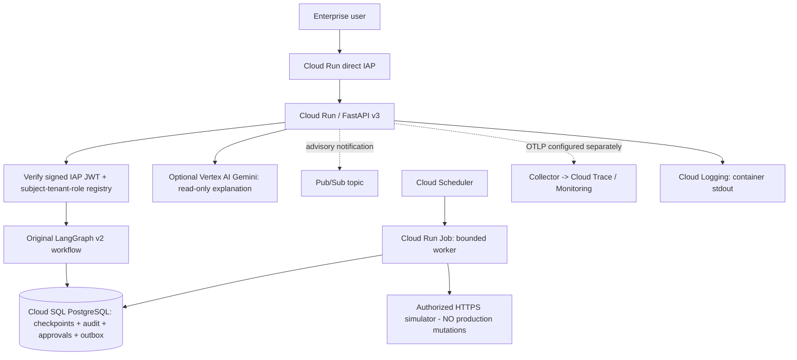

# Enterprise Agent Observability — GCP Edition v3.0

**An additive, Google Cloud-native edition of the original Azure + LangGraph reliability lab.**
It reuses the repository's v2 LangGraph state machine, PostgreSQL checkpointer,
one-time approvals, RLS-aware audit, transactional outbox, and fenced simulator
worker. No historical source files or previous Azure implementation are deleted.

> Maturity: **offline-tested GCP adapter + unverified GCP Terraform deployment**.
> The new GCP security/adapter tests pass in the artifact build environment.
> Cloud Run/IAP/Cloud SQL/Vertex/PubSub deployments have **not** been executed.
> The inherited integration suite still needs a real PostgreSQL/Docker environment.
> Real ServiceNow/Salesforce/Jira writes remain disabled in this edition.

## Architecture



The LLM has **no authority** to select a business tenant, grant a role, approve an
action, or perform a mutation. LangGraph governs **state transitions**. PostgreSQL
owns the **transactional approval/outbox state**. Pub/Sub provides only an optional
wake-up signal and is **not** a source of truth or an exactly-once guarantee.

## Legacy Azure vs. GCP integration map

| Existing Azure design | GCP edition | Current status |
| --- | --- | --- |
| Azure Container Apps | Cloud Run API / optional Cloud Run Job | Terraform scaffold, unvalidated |
| Entra ID JWT | Cloud Run IAP + signed IAP JWT verification | Implemented adapter, offline policy-tested |
| Azure Database for PostgreSQL | Cloud SQL PostgreSQL 16 | Terraform scaffold |
| Key Vault | Secret Manager | Terraform references to pre-created secrets |
| Bedrock/Azure model abstraction | Vertex AI Gemini via Google Gen AI SDK | Optional code path, not cloud-tested |
| Azure message mechanism | Pub/Sub outbox notification | Optional best-effort publisher |
| Grafana/Tempo/Dynatrace | Cloud Logging / Cloud Trace + OTLP | Collector example, not provisioned |
| Scheduled worker | Cloud Run Job + Cloud Scheduler | Optional Terraform scaffold |
| AKS/Container Registry patterns | Artifact Registry + Cloud Run | Registry provisioned; image must be built |

## Local validation (no Google project)

At repository root:

```bash
python -m pip install 'pytest>=8,<10' 'fastapi>=0.115,<1'
python -m pytest -q tests/test_gcp_edition.py
python -m compileall -q gcp_edition
```

For the **actual** database/checkpoint/approval/outbox path, install all requirements
and use the inherited PostgreSQL + simulator Compose integration gate:

```bash
python -m pip install -r requirements.txt -r gcp_edition/requirements-gcp.txt
bash scripts/run_reliability_lab.sh
```

The inherited gate requires Docker, PostgreSQL and installable dependencies;
passing the 9 offline tests is **not evidence** that the cloud or inherited
integration path works. Do not use the historical legacy demo headers as
production identity; use only the `/gcp/v3` application behind IAP.

## Deploying to GCP (manual, staged)

1. Create/select a GCP project with billing. Enable APIs listed in
   `infrastructure/gcp/main.tf`. Obtain access to Cloud SQL, Cloud Run,
   Secret Manager, IAP, Artifact Registry, and optionally Vertex AI.
2. Bootstrap *distinct low-privilege* PostgreSQL roles for app runtime,
   checkpointer and worker, then apply `governance/v1_schema.sql`,
   `governance/v11_schema.sql`, `governance/005_security_remediation.sql`
   and the repository's checkpoint setup with a privileged migration identity.
   Consult `docs/RECOVERY_VALIDATION.md` for RLS limitations. Plan DB
   provisioning carefully: the Terraform instance is initially empty, and the
   app must not receive owner, superuser or BYPASSRLS credentials.
3. Create Secret Manager secrets **before** planning Terraform: `eao-audit-dsn`,
   `eao-checkpoint-dsn`, and `eao-authz-registry`. The first two contain psycopg
   connection strings usable through the `/cloudsql/PROJECT:REGION:INSTANCE`
   Unix socket; the third contains the authorized subject→tenant/role JSON.
   Sample file: `gcp_edition/authz.sample.json`. It is *not* a live grant file.
   Use Secret Manager versions pinned to `1` in this lab. Never commit values.
4. Build an image with `docker build -f gcp_edition/Dockerfile -t IMAGE .` and
   publish an artifact to Artifact Registry. An optional Cloud Build pipeline is
   included as `gcp_edition/cloudbuild.yaml`; it runs offline policy tests before
   building/pushing. For Terraform, pin the published image by immutable digest.
   Terraform creates a repository, but you can first use an existing one to
   avoid a chicken-and-egg build/deploy cycle.
5. `cd infrastructure/gcp && cp terraform.tfvars.example terraform.tfvars`;
   replace all placeholder values. Run `terraform init`, `terraform plan`, and
   inspect permissions, cost estimates, ingress, regionality, and tenancy.
   Then apply in a disposable test project. Terraform has **not** been
   validated with the Google provider in this build environment.
6. Verify Cloud Run direct IAP. Allow only the desired identities through IAP
   IAM; `roles/run.invoker` on the service is reserved for the IAP service agent.
   The API re-verifies `X-Goog-IAP-JWT-Assertion` (ES256, audience, issuer, key,
   signature and expiry) and loads a trusted entitlement mapping from a mounted
   Secret Manager value. A user's email is **not** a tenant grant.
7. Activate `inference_provider="vertex"` only after testing Gemini access,
   quotas, safe prompt logging and cost limits. Run a read-only explanation.
8. Optional worker job requires `enable_worker=true` plus a separately
   deployed, allowlisted HTTPS simulator. Real provider writes are disabled.
   Validate network egress, idempotency, Cloud Scheduler IAM and lease recovery.

### Three API calls

When invoking through the IAP-protected Cloud Run URL with an authenticated user
who has the matching roles in the grant registry:

```bash
# start as Operator; replace URL and use your browser/authenticated IAP client
POST /gcp/v3/runs         {"account_id":"ACME"}
# receive run_id and risk_score (fixture risk score, NOT Vertex reasoning)
POST /gcp/v3/runs/{run_id}/decision  {"approved":true}  # different Approver
GET  /gcp/v3/runs/{run_id}                             # Auditor
GET  /gcp/v3/runs/{run_id}/explanation                 # Auditor / read-only
```

The API intentionally has **no insecure development bypass** for IAP. To test
end-to-end locally, run the original simulator/reliability suite or inject a
verified test principal via FastAPI dependency overrides in a private test
process; never deploy those overrides.

## Guarantees and explicit limitations

- **Existing code reused:** `app/v1_workflow.py`, `app/v2_service.py`,
  `app/v11_governance.py`, `app/reliability/governed_worker.py`, and
  PostgreSQL schema and checkpoint lifecycle.
- **New code:** IAP verification and tenant mapping, GCP FastAPI routes,
  Gemini status explainer, optional Pub/Sub publisher, telemetry config,
  Cloud Run Dockerfile, Terraform, new offline tests, CI workflow.
- **Security caveat:** the original checkpoint storage is not hardened for
  cross-tenant row-level segregation under a compromised database credential.
  Strong isolation needs an independently validated tenant-per-schema/DB or
  robust credential-bound checkpoint partitioning design.
- **Availability:** v3 cannot serve runs if PostgreSQL is unavailable.
- **No live cloud evidence:** no Terraform plan/apply, IAM/IAP live signing,
  Gemini inference, Pub/Sub publishing, or SaaS system mutation was verified.
- **Trace exporter:** the collector YAML is an example; the Terraform module
  does not provision an OTLP collector. Cloud Logging receives stdout from
  Cloud Run, but distributed trace linkage requires a correctly deployed
  collector and network/permission configuration.
- **Not exactly-once:** provider mutations need a trusted provider-side
  idempotency/reconciliation contract; Pub/Sub push is at-least-once and
  even pull exactly-once applies to message acknowledgments, not CRM actions.
- **Legacy routes:** historical v0-v2 demos remain in source, but only the new
  v3 service entrypoint is deployed by the GCP Dockerfile.

## Acceptance gates before claiming production-readiness

1. PostgreSQL Docker reliability suite and duplicate-outbox simulations pass.
2. IAP bearer/JWT cryptographic tests with genuine GCP signed assertions pass.
3. Tenant cross-access negatives, distinct operator/approver, RLS and
   checkpoint isolation threat model are reviewed and tested.
4. Cloud Run API + private Cloud SQL socket, separate DB roles and secrets
   connect, restart and recover cleanly.
5. Live Vertex AI quota/cost telemetry, Cloud Trace exports, Cloud Logging
   and alerting are verified.
6. Privately deployed provider simulator proves ambiguous write reconciliation
   across Cloud Run Job retries/crashes.
7. Terraform destroy plan and budget alerts are reviewed (Cloud SQL incurs cost).

## Verified official references

- [Google Cloud: Cloud Run direct IAP](https://docs.cloud.google.com/run/docs/securing/identity-aware-proxy-cloud-run)
- [Google Cloud: IAP signed JWT verification](https://docs.cloud.google.com/iap/docs/signed-headers-howto)
- [Google Cloud: Cloud SQL + Cloud Run](https://docs.cloud.google.com/sql/docs/postgres/connect-run)
- [Google Cloud: Gemini Vertex AI quickstart](https://docs.cloud.google.com/vertex-ai/generative-ai/docs/start/quickstart)
- [Google Cloud: Pub/Sub semantics](https://docs.cloud.google.com/pubsub/docs/exactly-once-delivery)
- [Google Cloud: scheduled Cloud Run Jobs](https://docs.cloud.google.com/run/docs/execute/jobs-on-schedule)
- [Google Cloud: Agent Runtime with LangGraph](https://docs.cloud.google.com/gemini-enterprise-agent-platform/build/runtime/quickstart)

## Next version: v3.1

Add a standalone Google Cloud *agent runtime comparison* (`Cloud Run +
Cloud SQL` versus `Gemini Enterprise Agent Platform Agent Runtime`), plus
BigQuery tenant-filtered audit analytics, evaluation datasets, cost/tracing
regressions, and stronger checkpointer tenancy. ADK and CrewAI are comparison
tracks; **LangGraph remains the orchestration engine** of this repository.
